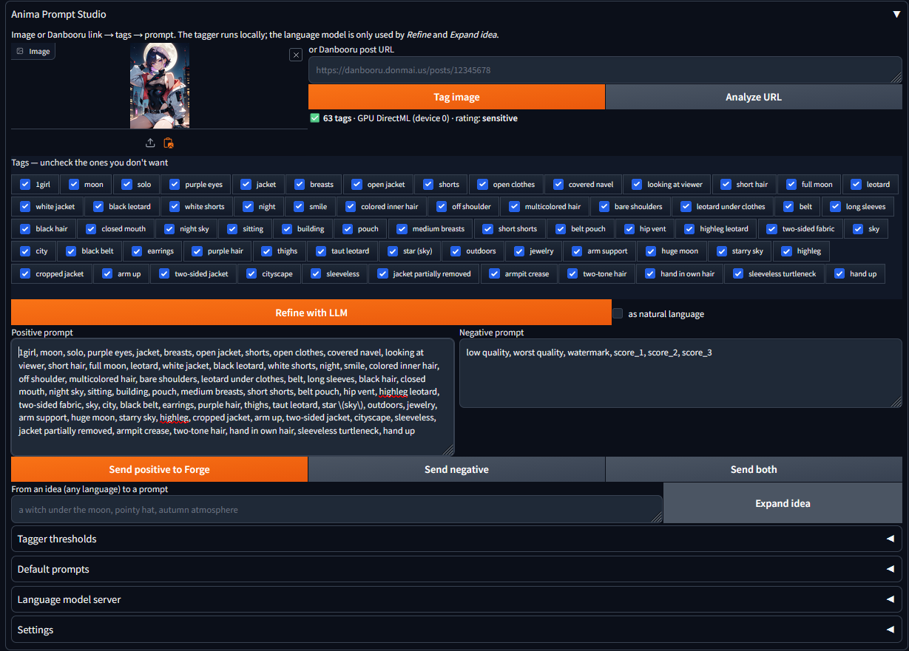

# Anima Prompt Studio

An extension for **Stable Diffusion WebUI Forge (Neo)** that builds clean,
ready-to-use prompts for anime models. Start from a picture, a Danbooru
post, an idea in your own language, or any Danbooru character or artist; pick the tags you want; send the result to Forge with one click.

```
an image          ->  WD tagger (runs locally)       ┐
a Danbooru link   ->  Danbooru API                   │
an idea           ->  your language model            ├─> tag list ─> prompt ─> Forge
character/artist  ->  local database (offline)       ┘      ▲
                        filters, swap the character, LLM ───┘
```

Made for anime models such as Anima, Illustrious and NoobAI, but the output is
plain Danbooru tags, so it works with any tag-based model.



## What it does

### Get the tags
- **Tag an image** — drop or paste (Ctrl+V) a picture and press *Tag image*.
  A WD v3 tagger (EVA02-Large by default) reads it **on your PC**: on the GPU
  through DirectML (Windows: AMD, NVIDIA, Intel) or CUDA, or on the CPU.
  Nothing is uploaded.
- **Analyze a Danbooru link** — paste a Danbooru post
  (`https://danbooru.donmai.us/posts/…`) and press *Analyze URL*: you get the exact tags of the post, already split into
  character, series, artist and general, plus a preview of the image (which
  you can then run through the tagger too).
- **Paste Danbooru post data** — when Danbooru blocks automatic requests
  (Cloudflare's "Just a moment…" check), open the post in your browser,
  copy the whole page and paste it here: the same tags are read from the copied text.
- **Expand an idea** — write a scene in any language ("a witch under the
  moon") and your language model turns it into a full tag set.

### Characters and artists
- **Offline character/artist search** — about 245,000 Danbooru characters and
  420,000 artists in a local database: search by name, appearance
  (`blue hair, twintails`) or series, sorted by popularity. *Add to tags*
  puts the character's name, series and appearance tags (or the artist as
  `@name`) at the top of the tag list. Searching never uses the internet.
- **Swap the character** — *Remove character tags* unchecks everything that
  describes who is in the picture (name, series, hair, eyes, ears, wings…)
  and what they wear (clothes, shoes, accessories), and keeps pose,
  expression and background. Add another character from the search and you
  get the same scene with a different character. Adding a character does
  this automatically (it can be turned off).

### Clean, controllable prompts
- **Pick the tags you want** — every tag is a checkbox; uncheck one and the
  prompt rebuilds itself.
- **No unwanted text in the picture** — tags that would make the model draw
  text or marks are always left out: `watermark`, `signature`,
  `artist name`, `patreon username`, `twitter username`, `web address`,
  logos, `dated`, `english text`, `japanese text`…, `speech bubble`,
  `thought bubble`, and censorship tags (`censored`, `uncensored`,
  `mosaic censoring`, `bar censor`…). The artist tags of posts are left out
  too, unless you turn on *Settings → Output → Keep artist tags*.
- **Default prompts** — a prefix added to every prompt (quality tags, LoRAs…)
  and a default negative prompt.
- **Refine with an LLM** (optional) — clean up and enrich the tags, or rewrite
  them as a natural-language prompt.
- **Send to Forge** — positive, negative or both, straight into the txt2img or
  img2img prompt fields.

### Your PC, your choice
- **Any language model server** — LM Studio, Ollama, Jan, llama.cpp,
  KoboldCpp, a remote provider… anything OpenAI-compatible. Only needed for
  *Refine* and *Expand idea*; everything else works without it.
- **GPU friendly** — the tagger and an optional llama.cpp server started by the
  extension are unloaded/stopped when you press **Generate**, so image
  generation gets the whole GPU.
- **Private by design** — no telemetry, the WebUI environment is never
  modified, and network requests happen only when you press a button (see
  *Privacy* and *Security checks* below).

## Installation

1. In Forge: **Extensions → Install from URL**, paste
   `https://github.com/sbaurizio/anima-prompt-studio`, press **Install**, then
   restart the WebUI.
   Or clone it into `extensions/`:
   ```
   git clone https://github.com/sbaurizio/anima-prompt-studio extensions/anima-prompt-studio
   ```
2. On first start (Windows), `install.py` downloads `onnxruntime-directml`
   into the extension's own `vendor/` folder. **The WebUI virtual environment
   is not modified.** On Linux/macOS the onnxruntime already in the WebUI
   environment is used.

## First-time guide

About ten minutes, once. Everything happens in the **txt2img** tab: scroll
down to the extensions area and expand **Anima Prompt Studio**.

### 1. Download what the extension needs (once)

1. Open **Settings → Tagger** and press **Download model** (~1.2 GB for
   EVA02-Large; smaller models are in the list). Wait for "downloaded".
   - **From where:** Hugging Face, the public repository of the model chosen
     in *Model* — by default
     [SmilingWolf/wd-eva02-large-tagger-v3](https://huggingface.co/SmilingWolf/wd-eva02-large-tagger-v3).
     Only two files are downloaded:
     `https://huggingface.co/<model>/resolve/main/model.onnx` and
     `…/selected_tags.csv`. No account or login is needed.
   - **To where:** `models/<model name>/` inside the extension folder (e.g.
     `extensions/anima-prompt-studio/models/wd-eva02-large-tagger-v3/`).
   - If you already have a WD v3 model, set *Custom model folder* to the
     folder with `model.onnx` and `selected_tags.csv` instead: nothing is
     downloaded.
2. Open **Settings → Tag browser** and press **Download data** (~70 MB). The
   status shows "database built: … characters, … artists" when it is ready.
   - **From where:** Hugging Face, the public dataset
     [Laxhar/noob-wiki](https://huggingface.co/datasets/Laxhar/noob-wiki).
     Only two files are downloaded:
     `https://huggingface.co/datasets/Laxhar/noob-wiki/resolve/main/danbooru_character.csv`
     and `…/danbooru_artist.csv`. No account or login is needed.
   - **To where:** `data/noob-wiki/` inside the extension folder (or the
     *Data folder* set in the same tab). The search database
     `data/tags.sqlite` is then built from them on your PC.
   - To download them by hand instead, see *Characters & artists → Data*
     below.
3. Optional: open **Default prompts**, write your quality tags or LoRAs in
   *Prefix* (e.g. `masterpiece, best quality`) and your negative prompt, and
   press **Save as default**.

### 2. Your first prompt from a picture

1. Drop an image into **Image** (or click the clipboard icon / press Ctrl+V).
2. Press **Tag image**. The first time the model loads (a few seconds); the
   status line then shows how many tags were found and whether the GPU was
   used.
3. Look at the tag list: uncheck what you don't want. The **Positive prompt**
   box updates by itself.
4. Press **Send positive to Forge** (or *Send both*), then **Generate** as usual.

### 3. From a Danbooru post

1. Paste the post link into **Danbooru post URL** and press
   **Analyze URL**. The tags and the image preview appear.
2. If the status line says that Cloudflare is blocking the request: click the
   link it shows, press **Ctrl+A** then **Ctrl+C** in your browser, paste into
   **Paste Danbooru post data** (just below) and press **Read pasted data**.
3. Uncheck what you don't want, then **Send positive to Forge**.

### 4. Put another character in the same scene

1. Get the tags of a picture or post (steps 2 or 3).
2. Open **Characters & artists (offline)**, type a name (e.g. `frieren`) and
   press **Search**. Click a row: you see its appearance tags and, if
   available, a thumbnail.
3. Press **Add to tags**. The original character's name, look and outfit are
   unchecked and the new character is added at the top; pose, expression and
   background stay. (To keep the original tags, untick *Remove the image's
   character tags when adding a character* first.)
4. Want an artist's style too? Switch *Type* to **Artists**, search, click a
   row and press **Add to tags** (it is added as `@name`).
5. **Send positive to Forge** and generate.

You can also use **Remove character tags** on its own, next to *Refine with
LLM*, and **Remove from tags** to take back the character or artist you
added.

### 5. Optional: a language model for *Refine* and *Expand idea*

1. Start your server (LM Studio, Ollama, Jan…) and load a model.
2. In **Settings → Inference server**, set its address (examples in
   *Inference server examples* below), press **Fetch models / test
   connection**, pick the model and press **Save settings**.
3. Now **Refine with LLM** cleans up the tag list (or writes a sentence with
   *as natural language*), and **Expand idea** turns a description in any
   language into tags.

If something does not work, see *Troubleshooting* at the end.

## Settings

All settings live in the **Settings** panel inside the extension (txt2img tab)
and are saved to `settings.json` in the extension folder. That file is created
on first run and is excluded from git.

| Tab | What you set |
|---|---|
| Inference server | Server URL (`…/v1`, must include the port), optional API key, model, temperature, max tokens, timeout, *Disable thinking*, *Allow explicit tags* |
| Auto start/stop | Optional: path to `llama-server`, `.gguf` model, context size, GPU layers, extra arguments, stop on Generate |
| Tagger | WD v3 model, download, custom model folder, GPU on/off, device id, unload on Generate (thresholds are the sliders in *Tagger thresholds*) |
| Danbooru | Optional username + API key (public posts work without) |
| Output | Underscores, parentheses escaping, duplicate removal, max tags (also applied to characters and artists), keep the artist tags of Danbooru posts (off by default) |
| Tag browser | Data folder for the character/artist database, *Download data*, *Check data* |
| Privacy | Delete all temporary images when the WebUI closes and starts (see *Privacy* below) |

### Tagger and GPU

The tagger picks the GPU automatically; there is nothing to configure in most
cases.

| System | What is used |
|---|---|
| Windows, any DirectX 12 GPU (AMD, NVIDIA, Intel) | GPU through **DirectML**, installed by `install.py` into `vendor/` |
| Linux / Windows with `onnxruntime-gpu` in the WebUI environment | NVIDIA GPU through **CUDA** |
| Anything else (Linux without `onnxruntime-gpu`, macOS) | CPU |

How it works:

1. When you first press **Tag image**, the model is loaded on the first
   available GPU provider (CUDA, then DirectML).
2. If the GPU cannot be used (old driver, not enough VRAM…), the tagger falls
   back to the **CPU** by itself, without errors. CPU tagging works the same,
   just slower (about 2 s per image instead of a fraction of a second).
3. The status line after tagging shows what was used, e.g.
   `GPU DirectML (device 0)` or `CPU (GPU failed: …)`.

**Two GPUs** (e.g. a laptop with integrated graphics plus a dedicated card):
`device 0` may be the integrated one. Set *GPU device id* to `1` to use the
other card. Untick *Use GPU* to force the CPU.

**VRAM**: once loaded, the tagger keeps about 1 GB of VRAM (EVA02-Large;
smaller models use less). With *Unload the tagger when Generate is pressed*
(on by default) that memory is released before every image generation; the
next tagging reloads the model, which takes a few extra seconds. Turn it off
if you have plenty of VRAM and tag often.

### Inference server examples

Default addresses of the most common servers (check your app if you changed
the port):

| Server | Server URL | API key |
|---|---|---|
| [llama.cpp](https://github.com/ggml-org/llama.cpp) `llama-server` | `http://127.0.0.1:8080/v1` | no (unless started with `--api-key`) |
| [LM Studio](https://lmstudio.ai) | `http://127.0.0.1:1234/v1` | no |
| [Ollama](https://ollama.com) | `http://127.0.0.1:11434/v1` | no |
| [Jan](https://jan.ai) | `http://127.0.0.1:1337/v1` | no (optional in Jan's settings) |
| [Unsloth Studio](https://unsloth.ai/docs/get-started/unsloth-studio) | `http://127.0.0.1:8888/v1` | **yes**: `sk-unsloth-…`, created in *Settings → API* |
| [KoboldCpp](https://github.com/LostRuins/koboldcpp) | `http://127.0.0.1:5001/v1` | no |
| [text-generation-webui](https://github.com/oobabooga/text-generation-webui) | `http://127.0.0.1:5000/v1` | no (start it with `--api`) |
| [vLLM](https://github.com/vllm-project/vllm) | `http://127.0.0.1:8000/v1` | no (unless set) |
| [LocalAI](https://localai.io) | `http://127.0.0.1:8080/v1` | no (unless set) |
| Remote providers (e.g. [OpenRouter](https://openrouter.ai)) | e.g. `https://openrouter.ai/api/v1` | **yes** |

Press **Fetch models / test connection** to check the address and fill the
model list. The LLM is only needed for *Refine* and *Expand idea*; tagging and
Danbooru work without it.

**Privacy note:** with a local server nothing leaves your PC. With a remote
provider, the tags or ideas you send are processed by that provider under its
own terms.

**Models:** any instruction-tuned chat model works. GGUF builds from
publishers such as [Unsloth](https://huggingface.co/unsloth) (the "UD" Dynamic
quants), bartowski or lmstudio-community run in all the local servers above.
Small models (≤4B) are fast but follow the format less reliably.

### Auto start/stop (optional)

**Only for llama.cpp users.** If you use LM Studio, Ollama, Jan (the app),
KoboldCpp or a remote server, leave it off: those start and stop on their own,
and the extension never touches them.

*Inference server* tells the extension **where** the language model is. This
tab lets the extension also **launch** llama.cpp's `llama-server` for you, so
the model uses VRAM only when needed — handy when it shares the GPU with image
generation.

To use it:

1. Enable *Start and stop a local llama-server automatically*.
2. Set the path to the `llama-server` executable and to a `.gguf` model.
   These are the only required fields.
3. In *Inference server* you can leave *Server URL* empty (then
   `http://127.0.0.1:8080/v1`, llama-server's default, is used) and *Model*
   empty (the model just loaded is used).

**You don't need to install llama.cpp separately if you have Jan or LM
Studio**: both ship `llama-server` inside their folders, and their models are
plain `.gguf` files. On Windows:

| App | `llama-server.exe` | Models (`.gguf`) |
|---|---|---|
| LM Studio | `%USERPROFILE%\.lmstudio\extensions\backends\llama.cpp-<version>\llama-server.exe` | `%USERPROFILE%\.lmstudio\models\<publisher>\<model>\*.gguf` |
| Jan | `%APPDATA%\Jan\data\llamacpp\backends\<version>\<build>\build\bin\llama-server.exe` | `%APPDATA%\Jan\data\llamacpp\models\<model>\model.gguf` |

Paths can contain `%USERPROFILE%` / `%APPDATA%`. Pick the backend that matches
your GPU (e.g. `vulkan` for AMD/Intel, `cuda` for NVIDIA). When an app
updates, the version folder may change and the path must be updated.
Use a port other than the app's own server (the default 8080 is fine; LM
Studio uses 1234, Jan 1337) so both can run side by side.

The server starts when you press **Start server** or the first time
*Refine*/*Expand idea* needs it, and it stops:

- when you press **Generate** (can be turned off);
- always when the WebUI closes, even if the console window is closed or the
  WebUI crashes.

It is never started on a port that another program is already using. Only a
process started by the extension, or a leftover process named `llama-server`
on that same port, is ever stopped.

llama.cpp is **not** included in this extension: you install it separately
(or use the copy shipped with another app), and the extension only launches
that executable.

### Characters & artists (offline)

Open **Characters & artists (offline)** under the tag list.

1. Choose *Characters* or *Artists* and type a name or tags (comma = AND,
   e.g. `blue hair, twintails`); *Series* and *Minimum posts on Danbooru*
   narrow the results. Results are sorted by popularity, 50 per page.
2. Click a row: the preview (if a thumbnail exists), the series and the tags
   that will be added appear. You can edit those tags before adding them;
   *Include appearance tags* adds the character's hair, eyes, outfit…
3. **Add to tags** puts them at the start of the tag list; the Positive prompt
   rebuilds itself (default prefix, parentheses escaping and duplicate
   removal from *Settings → Output* apply). Then **Send positive to Forge**.
   - *Replace the previous character/artist* (on by default): a new character
     replaces the character added before, a new artist the artist added before,
     so you can have one of each.
   - *Remove the image's character tags when adding a character* (on by
     default): see below.
4. **Remove from tags** takes out the character (or artist, depending on
   *Type*) added from the browser. Tags that were also in the image stay.

Tags added from the browser stay in the list when you tag another image or
analyze another post, so you can try the same character in different scenes.

**Remove character tags** (next to *Refine with LLM*) unchecks the tags of the
character in the image or post, which you can check again by hand:

- tags that Danbooru or the tagger mark as *character* or *copyright*;
- the appearance tags the database lists for that character (e.g. for
  Hatsune Miku: aqua hair, twintails, detached sleeves…);
- body traits by pattern: hair color/length/style, eye color, skin, animal
  ears, horns, tails, wings, halo, fangs, moles, breast size;
- clothing and accessories, recognized by their last word: `white dress`,
  `black pantyhose`, `brown footwear`, `dangle earrings`, `long sleeves`,
  `hair ornament`, `glasses`…

People counts (`1girl`, `solo`…), pose, expression, background, objects
(`holding sword`, `bow (weapon)`) and artist tags are kept, as are the tags
you added from the browser.

#### Data

Everything lives in the extension's own `data/` folder (excluded from git); a
different folder can be set in *Settings → Tag browser*.

```
data/
  noob-wiki/danbooru_character.csv   <- Hugging Face: Laxhar/noob-wiki
  noob-wiki/danbooru_artist.csv
  characters/thumbs/<trigger>.webp   (optional thumbnails)
  artists/thumbs/<trigger>.webp
  tags.sqlite                        (built automatically)
```

*Download data* fetches the two CSV files from the public dataset
[Laxhar/noob-wiki](https://huggingface.co/datasets/Laxhar/noob-wiki) (no
account needed) and builds `tags.sqlite`. To do it by hand, from the extension
folder in PowerShell:

```powershell
New-Item -ItemType Directory -Force data\noob-wiki
curl.exe -L -o data\noob-wiki\danbooru_character.csv https://huggingface.co/datasets/Laxhar/noob-wiki/resolve/main/danbooru_character.csv
curl.exe -L -o data\noob-wiki\danbooru_artist.csv https://huggingface.co/datasets/Laxhar/noob-wiki/resolve/main/danbooru_artist.csv
```

The database is built on the first search (a few seconds). After replacing a
CSV press **Rebuild database from CSV**.

**Your own CSV**: the file names must be `danbooru_character.csv` and
`danbooru_artist.csv` (UTF-8, header row, values with commas in quotes).
Extra columns are ignored.

| File | Columns |
|---|---|
| characters | `character` (required, unique), `trigger` (name shown and inserted), `copyright` (series), `core_tags` (appearance tags), `count` (popularity: sort order and *Minimum posts*) |
| artists | `artist` (required, unique), `trigger`, `count` |

**Thumbnails** (optional) are matched by name:
`data/characters/thumbs/<trigger>.webp` (the characters `< > : " / \ | ? *`
in the trigger are replaced by `_`). Without a thumbnail the preview is empty.

### Prompts sent to the language model

The same instructions are sent to every model, whatever server you use. They
ask for comma-separated Danbooru tags (*Refine*, *Expand idea*) or a single
English paragraph (*as natural language*). Bigger models follow them more
reliably; very small models may need a second try.

*Disable thinking* (on by default) stops reasoning models (Qwen3, Gemma 4,
DeepSeek-R1 style…) from "thinking" for hundreds of tokens before answering,
which can make a request 5× slower. Every server has its own switch, so the
extension sends both common ones: `chat_template_kwargs.enable_thinking=false`
(llama.cpp, Jan) and `reasoning_effort="none"` (LM Studio, OpenAI-style
servers). If a server rejects them, the request is retried without. Some apps
also have their own thinking toggle in the model settings.

| Server | Disable thinking |
|---|---|
| llama.cpp, LM Studio | tested, works |
| Jan, Unsloth Studio (both run llama.cpp), vLLM | expected to work |
| Ollama, KoboldCpp, text-generation-webui, remote providers | depends on version/model |

If it is not supported nothing breaks: the answer is just slower. Some models
always reason and cannot be switched off (e.g. DeepSeek-R1); models without
reasoning are not affected at all.

## Privacy

- The tagger runs entirely on your machine; **images are never uploaded**.
- Network requests happen only when you ask for them:
  - Danbooru: the post you pasted, and its image for the preview
    (`danbooru.donmai.us`, `cdn.donmai.us`);
  - Hugging Face (`huggingface.co`, which hands large files to its own
    download servers): the tagger model files from the `SmilingWolf/…`
    repository you chose, when you press *Download model*, and the two
    character/artist CSV files from the `Laxhar/noob-wiki` dataset, when you
    press *Download data*;
  - your inference server: the tags/idea you send to it, at the URL you set;
  - PyPI: `onnxruntime-directml`, once, on Windows during install.
- Searching characters and artists never uses the network: it reads the
  local database only.
- No telemetry, analytics or tracking of any kind.
- Personal settings, API keys and logs stay in `settings.json` and
  `anima.log`, both excluded from git.
- **Temporary copies on disk.** To show an image in the browser, the WebUI
  (Gradio) keeps a copy of it in a temporary folder (`%TEMP%\gradio` on
  Windows, plus Forge's `tmp`). This applies to everything shown in the WebUI,
  including your generated images, and those copies are normally never
  deleted. This extension:
  - downloads Danbooru previews into memory (the WebUI still makes its own
    display copy, which is removed by the cleanup below);
  - deletes the temporary copy of an image right after tagging it (the
    picture stays in memory, so you can tag it again);
  - optionally (*Settings → Privacy*, off by default) deletes **all**
    temporary images when the WebUI closes — Ctrl+C, restart, or closing its
    console window — and again when it starts, as a safety net for crashes
    or a killed process (which cannot run anything on exit). Forge's output
    folders are never touched. If you run two WebUI instances at the same
    time, closing or starting one also clears the other one's temporary
    images.
  - character/artist thumbnails are read into memory; the file in `data/`
    is never changed (the WebUI's display copy is cleaned the same way).

## Security checks

What the extension does to protect your WebUI, your PC and your data. Each
point is in the code and can be checked there.

**WebUI and Python environment**

- The WebUI virtual environment is never modified: `install.py` installs only
  `onnxruntime-directml`, with `--no-deps`, into the extension's own `vendor/`
  folder, and only on Windows. `vendor/` is put on `sys.path` by this
  extension only.
- The bundled modules are loaded under the private package name
  `anima_core`, so they cannot replace or clash with modules of Forge or of
  other extensions.
- Any error while loading disables the extension and shows the error in its
  panel; the WebUI keeps working.
- The panel never changes image generation: it passes nothing to Forge's
  processing, it only writes text into the prompt fields when you press a
  *Send* button.

**Network**

- No request happens by itself; each one is started by a button (list in
  *Privacy* above). No telemetry.
- Danbooru: only the hosts `danbooru.donmai.us` and its official mirrors are
  accepted for a post link, the post id must be a number, and the preview
  image is downloaded only over `https` from Danbooru's own servers
  (`*.donmai.us`), whatever URL the API answer contains.
- Cloudflare's anti-bot check is never bypassed: when it answers, the
  extension stops and offers *Paste Danbooru post data*, where your own
  browser fetches the page. The pasted text is only read as data (JSON or
  plain text, never run) and must look like a Danbooru post.
- Hugging Face: only the fixed file names of the chosen tagger model and of
  the `Laxhar/noob-wiki` dataset are requested; nothing about you is sent.
  Downloads go to a `.part` file first, so an interrupted download never
  leaves a broken model or CSV.
- Language model: only the server URL you set is contacted, and only by
  *Refine*, *Expand idea*, *Fetch models* and *Check status*.

**Character/artist database**

- Searches are offline and use parameterized SQL queries: what you type is
  never pasted into the query, so it cannot change it. The table name comes
  from a fixed list, never from the user. Paging values are parameters too,
  and `%` / `_` you type are searched literally, not as wildcards.
- The database is opened **read-only** for searches; it is written only by
  *Rebuild database* / *Download data*, from the local CSV files, into a
  temporary file that replaces the old one only when complete. Building and
  searching never run at the same time, so a rebuild cannot break a search
  or leave a half-written database.
- Thumbnail file names are built from the character name with every
  character that is not allowed in a file name (`< > : " / \ | ? *`) replaced,
  including the path separators, and `.webp` added, so a name can never
  point outside the `thumbs` folder.

**Programs started by the extension**

- `llama-server` is started only if you enable *Auto start/stop* and set its
  path; it is run directly, without a shell, with its arguments passed as a
  list, and tied to the WebUI process so it closes with it.
- Only the process started by the extension, or a leftover process named
  `llama-server` on the same port, is ever stopped. A port already used by
  another program is never taken over.
- No code from the network, from data files or from settings is ever run:
  there is no `eval`/`exec`, and no `pickle` loading.

**Your data and files**

- Settings, server addresses, model paths and API keys are stored only in
  `settings.json` in the extension folder; logs only in `anima.log`. Both,
  plus `models/`, `vendor/` and `data/`, are excluded from git.
- API key fields are password fields (hidden on screen).
- The panel's fields are not saved to Forge's `ui-config.json`, so API keys
  never end up there and saved settings are not overwritten by stale values.
- Temporary image cleanup deletes only image files inside Gradio's and
  Forge's temporary folders, and skips any folder that overlaps Forge's output
  folders: your saved images are never touched.
- The temporary copy of an image you tag is deleted right after tagging.

## Troubleshooting

- **The panel says "Extension not active"**: the message shows the import
  error. Usually onnxruntime could not be loaded; delete `vendor/` and restart
  the WebUI to reinstall it.
- **"Tagger model not found"**: download it from *Settings → Tagger*, or fix
  *Custom model folder*.
- **"Cannot reach …"**: your inference server is not running or the URL is
  wrong; use *Fetch models / test connection*.
- **Empty answers from a reasoning model**: enable *Disable thinking* or raise
  *Max tokens*.
- **The clipboard button doesn't paste**: the browser may be blocking clipboard
  access (allow it from the icon left of the address bar), or the clipboard
  holds a copied file rather than an image. Clicking the page and pressing
  **Ctrl+V** works in both cases.
- **Tagging is slow / the status says CPU**: see *Tagger and GPU* above
  (driver, *GPU device id*, or Linux without `onnxruntime-gpu`).
- **"Danbooru's protection (Cloudflare) is blocking requests"** when analyzing
  a link: Danbooru sits behind Cloudflare, which sometimes shows an anti-bot
  check ("Just a moment…") to a whole internet connection. Only a real browser
  can pass it, and the extension never tries to get around it. It is not a
  setting of the extension and the DNS you use does not matter: it depends on
  your public IP. It usually goes away by itself; restarting the router (most
  providers then give a new IP) or another network (e.g. a phone hotspot)
  helps. Meanwhile use **Paste Danbooru post data** (under *Analyze URL*):
  1. open the post in your browser (it passes the check): the normal page
     works, and so does the `.json` link shown in the status line;
  2. press **Ctrl+A** then **Ctrl+C** (Firefox: open the *Raw Data* tab first);
  3. paste into *Paste Danbooru post data* and press **Read pasted data**.
  You get the same tags as *Analyze URL* (read from the tag list on the page,
  or from the JSON), with the same filters. If the
  preview is blocked too, drop the image saved from the browser into *Image*.
- **"Danbooru answered 403 (Forbidden)"** without the message above: the post
  may be restricted, or the username/API key in *Settings → Danbooru* is wrong.
- **The character search says "no CSV found"**: press *Download data* in
  *Settings → Tag browser*, or copy the CSV files into `data/noob-wiki/`.
- **The preview of a character is empty**: there is no thumbnail for it in
  `data/characters/thumbs/` (they are optional).
- `anima.log` in the extension folder records errors and server start/stop.

## Uninstall

Delete the `extensions/anima-prompt-studio` folder and restart the WebUI.
Nothing else is touched.

## Credits

- WD v3 taggers by [SmilingWolf](https://huggingface.co/SmilingWolf) (downloaded on demand)
- [ONNX Runtime](https://onnxruntime.ai) with DirectML (installed by `install.py`)
- Character and artist data: the [Laxhar/noob-wiki](https://huggingface.co/datasets/Laxhar/noob-wiki)
  dataset (downloaded on demand)

Works with, but does not include:

- [llama.cpp](https://github.com/ggml-org/llama.cpp) and any other
  OpenAI-compatible inference server

Developed with the assistance of [Claude](https://www.anthropic.com/claude) (Anthropic).

## License

[MIT](LICENSE). The WD tagger models (Apache-2.0) and ONNX Runtime (MIT) keep
their own licenses; they are downloaded at install/run time and are not part of
this repository.
